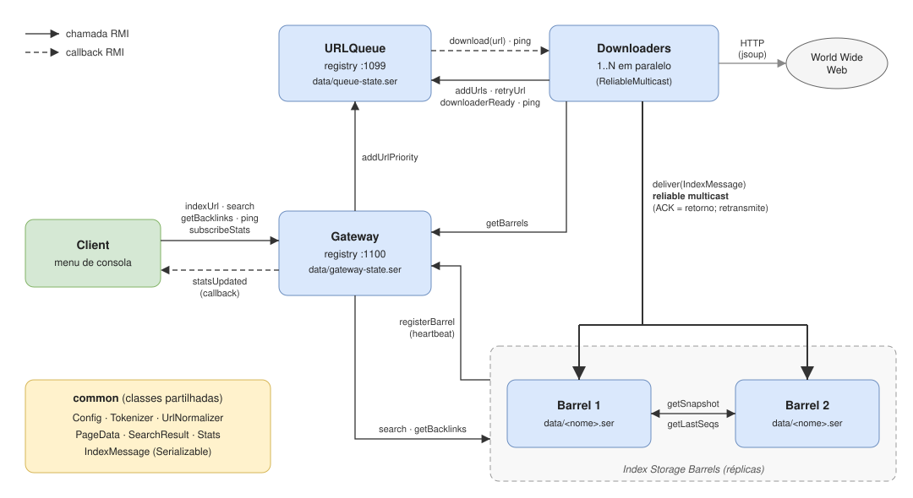
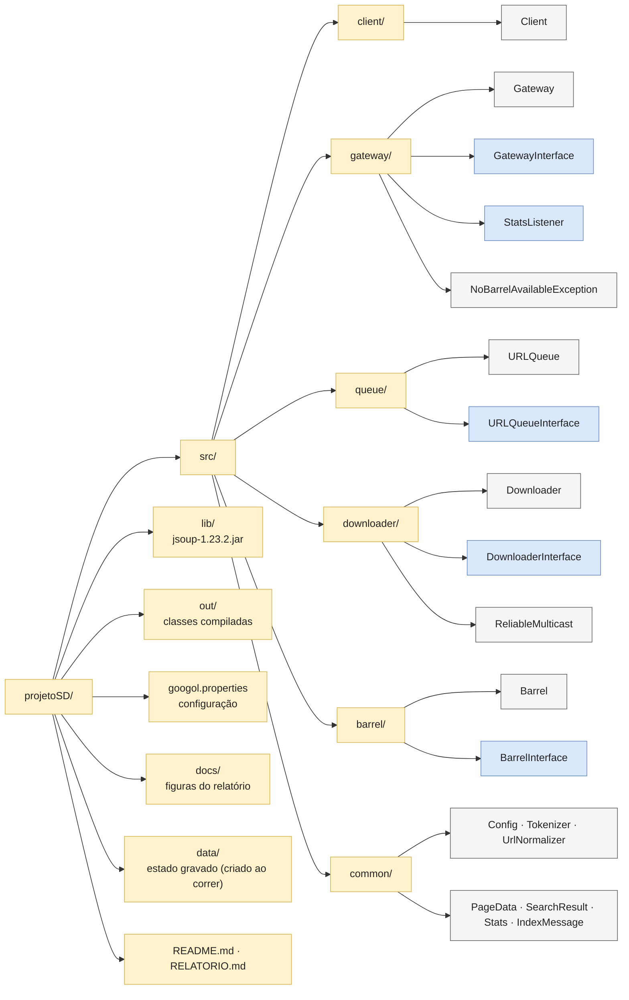

# Projeto de Sistemas Distribuídos 2026/2027

## Meta 1 - Googol: motor de pesquisa em Java RMI

1 de Novembro de 2026

**Membros do Grupo**

- Filipe da Cruz Simões – n.º 2024200991, PL7, uc2024200991@student.uc.pt
- Diogo António Mesquita Ferrão da Silva – n.º 2024199827, PL7, uc2024199827@student.uc.pt

---

## 1. Arquitetura de software

O Googol tem cinco programas independentes, que comunicam apenas por Java RMI e podem correr em
máquinas diferentes. Toda a configuração (endereços, portos, intervalos, ficheiros) está em
`googol.properties`, lida pela classe `common.Config`, por isso não é preciso recompilar.

- **URLQueue** (`queue`): fila de URLs por visitar e conjunto de URLs já vistos.
  Cria o seu próprio RMI registry (`rmi.port`).
- **Downloader** (`downloader`): obtém as páginas com o jsoup, extrai título, citação, palavras e
  ligações, envia a página aos Barrels e devolve as ligações à fila. Correm vários em paralelo.
- **Barrel** (`barrel`): réplica do índice invertido (palavra → URLs), das páginas
  (URL → título e citação) e das ligações recebidas (URL → URLs que apontam para ele).
  Grava tudo em `data/<nome>.ser`.
- **Gateway** (`gateway`): única entrada dos clientes. Não guarda o índice: escolhe um Barrel para
  cada pedido. Cria o seu próprio registry (`gateway.port`).
- **Client** (`client`): menu de consola que só invoca métodos da Gateway.

*Figura 1: Componentes e chamadas RMI entre eles (fonte editável em draw.io: `docs/arquitetura.drawio`).*

As classes partilhadas estão em `common`: `PageData`, `SearchResult`, `Stats` e `IndexMessage`
(passadas por valor, `Serializable`), `Tokenizer` e `UrlNormalizer`. Normalizar os URLs evita
visitar duas vezes a mesma página escrita de formas diferentes.

*Figura 2: Estrutura do projeto (Mermaid). A azul, as interfaces remotas (`extends Remote`): cada
programa implementa a sua (o `Client` implementa `StatsListener`, para receber as estatísticas por
callback) e só conhece os outros através delas. O pacote `common` tem as classes usadas por todos.*

**Fluxo da indexação.** O Client chama `indexUrl` na Gateway, que chama `addUrlPriority` na fila
(o URL entra no início). A thread *dispatcher* da fila junta um URL a um Downloader livre e chama
`download(url)` nele (callback). O Downloader processa o URL numa thread própria, envia a página aos
Barrels por reliable multicast, devolve as ligações com `addUrls` e avisa que está livre com
`downloaderReady`. Como cada URL só entra na fila uma vez (`seen`) e é tirado por um só dispatcher,
cada URL é indexado por um único Downloader.

**Fluxo da pesquisa.** A Gateway sorteia um Barrel com probabilidade proporcional ao inverso do seu
tempo médio de resposta (balanceamento por desempenho). O Barrel faz a interseção dos conjuntos de
URLs de cada termo, ordena pelo número de ligações recebidas e devolve 10 resultados de cada vez.

**Persistência.** Barrels, Gateway (URLs pendentes e contagens de pesquisas) e fila (URLs por
visitar, vistos e tentativas) gravam periodicamente e ao terminar. Escrevem num ficheiro temporário
e substituem o anterior com `ATOMIC_MOVE`, por isso um crash a meio nunca corrompe o ficheiro. No
caso do Barrel, só a cópia para memória é feita sob o lock; a escrita no disco é feita fora dele.

## 2. Componente RMI

*Tabela 1: Interfaces remotas.*

| Interface | Chamado por | Métodos |
|---|---|---|
| `GatewayInterface` | Client | `indexUrl`, `search`, `getBacklinks`, `getStats`, `subscribeStats`, `unsubscribeStats`, `ping` |
| | Barrel, Downloader | `registerBarrel` (heartbeat), `getBarrels` |
| `BarrelInterface` | Downloader | `deliver(IndexMessage)` |
| | Gateway | `search`, `getBacklinks` |
| | Barrel | `getSnapshot`, `getLastSeqs`, `getPageCount`, `getWordCount` |
| `URLQueueInterface` | Gateway, Downloader | `addUrlPriority`, `addUrls`, `retryUrl`, `downloaderReady`, `ping` |
| `DownloaderInterface` | URLQueue | `download(url)` (callback), `ping` |
| `StatsListener` | Gateway | `statsUpdated(Stats)` (callback) |

**Registo dos Barrels.** O RMI não deixa fazer `bind` num registry de outra máquina. Por isso cada
Barrel envia o seu stub à Gateway com `registerBarrel`, repetido a cada `barrel.heartbeat.ms`. O
registo é uma *lease*: sem heartbeat durante `gateway.barrel.timeout.ms`, o Barrel sai da lista. O
heartbeat leva também o tamanho do índice, mostrado nas estatísticas.

**Callbacks.** A fila entrega URLs aos Downloaders por callback (modelo *push*, sem espera ativa).
As estatísticas (top 10 de pesquisas, Barrels ativos com o tamanho do índice, tempo médio em décimas
de segundo) chegam ao Client por `statsUpdated`, apenas quando mudam.

**Failover e recuperação.**

- Se um Barrel falha durante uma pesquisa (`RemoteException`), a Gateway repete o pedido noutro
  Barrel e marca o primeiro como suspeito até ao próximo heartbeat. Sem Barrels ativos, o cliente
  recebe `NoBarrelAvailableException`.
- `rmi.timeout.ms` limita a ligação e a espera pela resposta. Assim, uma máquina que deixa de
  responder é tratada como avariada.
- O Client repete cada pedido até `client.retry.attempts` vezes. Os pedidos são idempotentes, por
  isso repetir é seguro. No ecrã de estatísticas, o Client deteta uma Gateway reiniciada com `ping`
  e volta a subscrever.
- Com a fila em baixo, a Gateway guarda (também em ficheiro) os URLs pedidos e reenvia-os quando ela
  voltar. Os Downloaders fazem `ping` à fila, voltam a ligar-se e guardam as ligações até as
  conseguirem enviar.
- A fila faz `ping` aos Downloaders com um URL em curso. Se um morrer a meio do download, o URL
  volta ao início da fila.

## 3. Replicação: reliable multicast

**Algoritmo.** Cada Downloader tem um identificador único (UUID) e numera as suas mensagens:
`IndexMessage(senderId, seq, página)`. Para cada Barrel da lista obtida da Gateway há um canal com
uma fila FIFO e uma thread própria, por isso um Barrel lento não atrasa os outros. A thread envia as
mensagens por ordem com `deliver`: o retorno normal é o **ACK**, e só então a mensagem sai da fila.
Com `RemoteException` (omissão ou avaria), a mensagem fica à frente e é retransmitida a cada
`multicast.retry.ms`. O Barrel ignora as mensagens com *seq* ≤ *lastSeq*[*senderId*], que são
retransmissões depois de um ACK perdido. O vetor `lastSeq` é gravado com o índice. Se não houver
Barrels, o Downloader espera (`wait`/`notifyAll`) em vez de perder a página.

Isto garante *integridade* (cada mensagem é entregue no máximo uma vez), *validade* e *acordo* (a
mensagem é retransmitida a cada Barrel até ao ACK) e *ordem FIFO* por emissor.

**Sincronização.** Cobre o que o multicast não garante sozinho: um Barrel morto antes de gravar, um
Barrel retirado da lista (os Downloaders descartam as suas mensagens) ou um Barrel novo. Ao
arrancar, o Barrel regista-se como "não pronto" (recebe mensagens, mas não pesquisas). Depois pede
`getSnapshot` ao Barrel com mais páginas e junta-o ao seu índice por *união*: os conjuntos só
crescem, por isso a ordem não importa e repetir não altera nada. O `lastSeq` fica com o máximo de
cada emissor. Volta a sincronizar-se quando a Gateway indica um registo novo (lease expirada ou
Gateway reiniciada). A cada heartbeat compara o seu `lastSeq` com o dos outros Barrels, obtido no
heartbeat anterior: se lhe faltar alguma mensagem, sincroniza-se.

## 4. Distribuição de tarefas

Seguimos a segunda divisão do enunciado: o mesmo número de funcionalidades para cada elemento, com
trabalho em todos os programas.

*Tabela 2: Distribuição de tarefas.*

| Nome 1 | Nome 2 |
|---|---|
| Indexar URL do utilizador (Client, `indexUrl`, `addUrlPriority`) | Pesquisa com todos os termos (Gateway, `Barrel.search`) |
| Indexação iterativa (URLQueue, Downloader, jsoup) | Ordenação por ligações recebidas |
| Ligações para uma página (`getBacklinks`) | Estatísticas em tempo real (callback `StatsListener`) |
| Resultados de 10 em 10 (Barrel, navegação no Client) | Balanceamento de carga e failover da Gateway |
| Reliable multicast (`ReliableMulticast`, `deliver`) | Recuperação da Gateway e do Client (estado em ficheiro, *retry*) |
| Downloaders em paralelo; um URL por Downloader | Sincronização de Barrels (extra) |
| Persistência dos Barrels e da fila | Registo dos Barrels com lease (heartbeat) |

## 5. Testes

Os testes são programas Java sem bibliotecas externas: `tests.UnitTests` (85 verificações, com
objetos reais e falsos, parte deles por RMI) e `tests.SystemTest` (38 verificações, com os cinco
programas em processos reais, um servidor HTTP local e avarias provocadas com `destroyForcibly`,
equivalente a `kill -9`). A Tabela 3 agrupa-os. Todos os resultados vêm da execução de 31 de
outubro (duas execuções de cada, todas PASS). A lista completa está no [Anexo A](#anexo-a-lista-completa-dos-testes).

*Tabela 3: Testes agrupados (U = unitário, S = sistema).*

| Descrição | Resultado |
|---|:---:|
| Configuração: valores, listas, UTF-8 e erros claros (U) | **PASS** |
| Extração com jsoup: título, citação, palavras e ligações normalizadas (U) | **PASS** |
| Normalização de URLs e de palavras (U) | **PASS** |
| Fila: URL entregue uma só vez, prioridade dos URLs do utilizador, limite de novas tentativas (U, S) | **PASS** |
| Indexação iterativa de 20 páginas a partir de um URL; Downloaders em paralelo (S) | **PASS** |
| Erros temporários (503) repetidos; permanentes (404, PDF) não (U, S) | **PASS** |
| Pesquisa AND, ordenação por ligações, 10 em 10 e backlinks no Barrel e na Gateway (U, S) | **PASS** |
| Reliable multicast: ordem, retransmissão, ACK perdido sem duplicados, espera sem Barrels (U) | **PASS** |
| Os dois Barrels ficam com índices idênticos (U, S) | **PASS** |
| Balanceamento por desempenho; failover com um Barrel avariado ou pendurado (U, S) | **PASS** |
| Estatísticas por callback, só quando mudam, com tempo médio em décimas de segundo (U, S) | **PASS** |
| Client: pesquisa com navegação, backlinks, indexação e estatísticas (U, S) | **PASS** |
| Barrel reiniciado recupera o índice do ficheiro e o que faltava de outro Barrel (U, S) | **PASS** |
| Barrel novo (vazio) sincroniza-se antes de responder a pesquisas (U, S) | **PASS** |
| Deteção de mensagens em falta pelos números de sequência (U) | **PASS** |
| Downloader morto livre e a meio de um download: o URL não se perde (U, S) | **PASS** |
| Fila reiniciada (incluindo `kill -9`): recupera o estado; Downloaders voltam a ligar-se (U, S) | **PASS** |
| Gateway reiniciada: Barrels e Client voltam a ligar-se; top 10 e URLs pendentes recuperados (U, S) | **PASS** |
| Client repete pedidos com a Gateway em baixo e desiste ao fim de N tentativas (U) | **PASS** |
| Tempo limite do RMI para máquinas que não respondem (U, S) | **PASS** |
| Erros de arranque (porto ocupado, configuração) com mensagem clara, sem stack trace (S) | **PASS** |
| Logs de todos os processos sem exceções inesperadas (S) | **PASS** |

---

## Anexo A. Lista completa dos testes

### Testes unitários (`tests.UnitTests`, 85)

| Teste | Resultado |
|---|:---:|
| Config: getInt | **PASS** |
| Config: getList ignora espaços e vazios | **PASS** |
| Config: lê UTF-8 | **PASS** |
| Config: chave em falta dá erro claro | **PASS** |
| Config: valor não numérico dá erro claro com o nome da chave | **PASS** |
| Config: ficheiro inexistente dá NoSuchFileException | **PASS** |
| Extract: título | **PASS** |
| Extract: palavras que só aparecem no título são indexadas | **PASS** |
| Extract: citação limitada a 150 caracteres + ... | **PASS** |
| Extract: palavras em minúsculas, com acentos, sem pontuação | **PASS** |
| Extract: links absolutos, normalizados, sem #, só http/https | **PASS** |
| Queue: URLs repetidos ou equivalentes entregues uma só vez; inválidos ignorados | **PASS** |
| Queue: no máximo 2 novas tentativas | **PASS** |
| Queue: URL prioritário passa à frente (novo e já na fila) | **PASS** |
| Queue: URL prioritário já visitado não é repetido | **PASS** |
| Queue: com RemoteException o URL volta ao início da fila e o dispatcher continua | **PASS** |
| Queue: com RuntimeException o URL volta ao início da fila e o dispatcher continua | **PASS** |
| UrlNormalizer: esquema/host em minúsculas, porto por omissão e # removidos, / no caminho vazio | **PASS** |
| UrlNormalizer: o caminho mantém maiúsculas (é distinto no servidor) | **PASS** |
| UrlNormalizer: rejeita o que não é http/https ou não tem host | **PASS** |
| UrlNormalizer: URL com caracteres inválidos é mantido (sem #) | **PASS** |
| Tokenizer: normaliza palavras | **PASS** |
| Tokenizer: texto vazio não dá palavras | **PASS** |
| Barrel: pesquisa só devolve páginas com TODOS os termos | **PASS** |
| Barrel: ordenado por links recebidos (a=3, b=1, c=0) | **PASS** |
| Barrel: resultado tem título e citação | **PASS** |
| Barrel: termo inexistente e pesquisa vazia não dão resultados | **PASS** |
| Barrel: backlinks ordenados, sem a ligação da página para si própria | **PASS** |
| Barrel: guardar a mesma página duas vezes é idempotente | **PASS** |
| Barrel: páginas de 10 resultados (10, 10, 5, 0) | **PASS** |
| Barrel: páginas diferentes não repetem resultados | **PASS** |
| Barrel: índice recuperado do ficheiro depois de reiniciar | **PASS** |
| Barrel: não ficam ficheiros temporários | **PASS** |
| Barrel: ficheiro corrompido não impede o arranque | **PASS** |
| Barrel.deliver: mensagem repetida (mesmo senderId e seq) é ignorada | **PASS** |
| Barrel.deliver: seq seguinte e outros Downloaders são entregues | **PASS** |
| Barrel.deliver: o filtro de repetidas sobrevive a um reinício | **PASS** |
| Multicast: todos os Barrels recebem todas as mensagens, por ordem | **PASS** |
| Multicast: Barrel com omissões recebe tudo por retransmissão, sem duplicados | **PASS** |
| Multicast: ACK perdido gera retransmissão, mas o Barrel entrega a página uma só vez | **PASS** |
| Multicast: sem Barrels espera e envia quando um Barrel aparece | **PASS** |
| Multicast: Barrel retirado da lista e a falhar deixa de ter mensagens pendentes | **PASS** |
| Multicast: Barrel ativo que ainda não voltou a registar-se continua a receber | **PASS** |
| Gateway: Barrel registado aparece na lista | **PASS** |
| Gateway: heartbeat renova o registo; sem heartbeat o Barrel é retirado; volta ao registar-se | **PASS** |
| Gateway: balanceamento por desempenho (os dois são usados, o mais rápido recebe mais) | **PASS** |
| Gateway: failover quando um Barrel falha; o avariado deixa de receber pesquisas e de contar como ativo, mas continua na lista dos Downloaders | **PASS** |
| Gateway: um heartbeat torna o Barrel suspeito de novo disponível | **PASS** |
| Gateway: backlinks com URL normalizado | **PASS** |
| Gateway: sem Barrels ativos dá NoBarrelAvailableException (mensagem para o cliente) | **PASS** |
| Stats: enviadas ao subscrever e quando um Barrel aparece; heartbeat igual não gera envio | **PASS** |
| Stats: top 10 conta termos normalizados e só a primeira página | **PASS** |
| Stats: tempo médio por Barrel em décimas de segundo (pesquisas de ~50 ms ≈ 0.5) | **PASS** |
| Stats: sem alterações não há envios (não há refrescamento periódico) | **PASS** |
| Stats: cliente desligado (RemoteException) deixa de receber | **PASS** |
| Gateway.indexUrl: com a fila em baixo o pedido fica pendente e é entregue, por ordem, quando ela volta | **PASS** |
| Gateway.indexUrl: URL novo vai para a fila; URL já visitado é indicado como conhecido | **PASS** |
| Gateway: subscrever duas vezes não duplica as atualizações das estatísticas | **PASS** |
| Gateway: Barrel a sincronizar-se recebe mensagens (lista dos Downloaders) mas não pesquisas nem conta como ativo | **PASS** |
| Gateway: registerBarrel indica registo novo no 1.º registo e depois de a lease expirar, não nas renovações | **PASS** |
| Barrel.merge: união de páginas, palavras e backlinks; juntar duas vezes não altera nada | **PASS** |
| Barrel.merge: lastSeq fica com o máximo por Downloader (repetidas continuam filtradas) | **PASS** |
| Barrel.merge: depois de juntarem os snapshots um do outro, os dois Barrels ficam idênticos | **PASS** |
| Barrel.synchronize: Barrel novo copia o índice de um ativo (ignora um em baixo) e grava-o; sozinho usa o índice local | **PASS** |
| Barrel.checkMissing: mensagem em falta detetada pelos números de sequência e recuperada; mensagem só a caminho não provoca sincronização | **PASS** |
| Gateway reiniciada recupera do ficheiro o top 10 e os URLs pendentes, entregues por ordem quando a fila volta | **PASS** |
| Gateway: ficheiro de estado corrompido não impede o arranque | **PASS** |
| Downloader: com a fila em baixo depois de indexar a página, guarda os links e envia-os quando ela volta | **PASS** |
| Downloader: 404 e PDF são permanentes; 429, 503 e timeout são temporários (repetidos) | **PASS** |
| Downloader: descrição das falhas sem nomes de exceções | **PASS** |
| Client: erro inesperado da Gateway mostra uma mensagem e o Client continua a funcionar | **PASS** |
| RMI: ligação a uma máquina que não responde falha ao fim do tempo limite (503 ms) | **PASS** |
| Queue: URL em curso de um downloader vivo (responde ao ping) não é entregue a outro | **PASS** |
| Queue: downloader morto a meio do download (ping falha): o URL volta à fila e vai para outro | **PASS** |
| Queue reiniciada recupera do ficheiro os URLs por visitar e o URL em curso (à frente), sem repetir os vistos | **PASS** |
| Queue reiniciada mantém o número de tentativas de cada URL | **PASS** |
| Queue: não ficam ficheiros temporários | **PASS** |
| Queue: ficheiro de estado corrompido não impede o arranque | **PASS** |
| Barrel: gravação com a escrita fora do lock e páginas a chegar em paralelo não perde páginas | **PASS** |
| Client: pesquisa de 10 em 10 com seguinte/anterior, fim dos resultados e backlinks do resultado N | **PASS** |
| Client: pesquisa sem resultados mostra mensagem e volta ao menu | **PASS** |
| Client: com a Gateway em baixo repete o mesmo pedido e conclui-o quando ela arranca | **PASS** |
| Client: desiste ao fim de N tentativas, avisa o utilizador e volta ao menu | **PASS** |
| Client: indexação com a resposta perdida é repetida e indicada como aceite (não como já conhecida) | **PASS** |
| Client: estatísticas por callback; Gateway reiniciada é detetada (ping) e o Client subscreve de novo | **PASS** |

### Testes de sistema (`tests.SystemTest`, 38)

| Teste | Resultado |
|---|:---:|
| Os dois Barrels registam-se na Gateway | **PASS** |
| Downloader arrancado antes da fila espera por ela e regista-se quando ela arranca | **PASS** |
| Indexação iterativa: 20 páginas visitadas a partir de /p0 | **PASS** |
| Downloaders em paralelo: os dois receberam URLs | **PASS** |
| Novas tentativas: erro temporário (503) tentado 3 vezes (1 + 2) e descartado | **PASS** |
| Erros permanentes (404, PDF) não são repetidos; mensagens sem nomes de exceções | **PASS** |
| Reliable multicast: os dois Barrels têm índices idênticos (20 páginas) | **PASS** |
| Pesquisa no Barrel: AND, ordenação por ligações recebidas, 10 em 10 e backlinks | **PASS** |
| Gateway: pesquisa (10 em 10) e backlinks iguais aos dos Barrels | **PASS** |
| Gateway: URL do utilizador é indexado e aparece na pesquisa; inválido e já conhecido são indicados | **PASS** |
| Estatísticas por callback: top 10, Barrels ativos com tamanho do índice e tempo médio; as pesquisas são distribuídas pelos dois Barrels | **PASS** |
| Estatísticas: sem alterações não há envios (não há refrescamento periódico) | **PASS** |
| Client: pesquisa de 10 em 10 com navegação, backlinks e indexação pela Gateway | **PASS** |
| Gateway: com B2 em baixo as pesquisas continuam (failover para B1); B2 deixa de contar como ativo | **PASS** |
| Avaria: fila detetou o downloader morto (RemoteException) | **PASS** |
| Avaria: o Downloader 2 indexou todos os 10 URLs novos | **PASS** |
| Barrel B2 em baixo: o sistema continua com B1 e o Downloader guarda as mensagens para B2 | **PASS** |
| Barrel B2 reiniciado recupera as páginas em falta (sincronização e retransmissão) e fica idêntico a B1 | **PASS** |
| Estatísticas: B2 volta a contar como ativo depois de reiniciar | **PASS** |
| Cada URL descarregado por um único downloader (31 URLs) | **PASS** |
| Erro previsível: segunda URLQueue no mesmo porto termina com mensagem clara | **PASS** |
| Erro previsível: segunda Gateway no mesmo porto termina com mensagem clara | **PASS** |
| Erro previsível: ficheiro de configuração inexistente dá mensagem clara | **PASS** |
| Erro previsível: valor inválido na configuração dá mensagem clara | **PASS** |
| Fila reiniciada: o Downloader deteta a falha, volta a ligar-se e continua a trabalhar | **PASS** |
| Gateway: URL pedido com a fila em baixo não se perde (pendente, reenviado e indexado) | **PASS** |
| Depois de a fila reiniciar, as páginas novas chegam aos dois Barrels | **PASS** |
| Gateway reiniciada: os Barrels voltam a registar-se e o Downloader volta a obter a lista | **PASS** |
| Gateway reiniciada: registo novo faz os Barrels sincronizarem-se de novo e continuam idênticos | **PASS** |
| Gateway reiniciada recupera do ficheiro o top 10 das pesquisas | **PASS** |
| Client: com a Gateway reiniciada volta a subscrever as estatísticas, continua a pesquisar e sai sem erros | **PASS** |
| Barrel novo (vazio) sincroniza-se com um Barrel ativo, fica idêntico e só então responde a pesquisas | **PASS** |
| Barrel morto antes de gravar (kill -9) recupera ao reiniciar o que faltava, a partir de outro Barrel | **PASS** |
| Barrel: arranca com o índice gravado e recupera-o depois de um crash | **PASS** |
| Barrel que não responde (máquina desaparecida): a Gateway desiste ao fim de rmi.timeout.ms e faz failover | **PASS** |
| Downloader morto a meio de um download: a fila deteta-o (ping) e o URL é indexado por outro Downloader | **PASS** |
| Fila morta (kill -9) recupera do ficheiro os URLs por visitar; os já vistos não se repetem | **PASS** |
| Logs sem exceções inesperadas nem ERROR | **PASS** |
